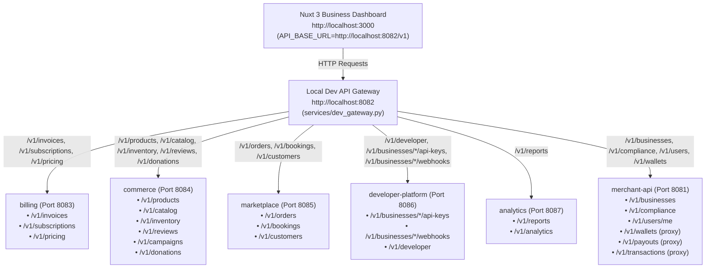

# PaveWay Local Development & Integrated Testing Guide

This guide provides step-by-step instructions for running and testing the **PaveWay Business Dashboard (`web/business`)** alongside the decomposed backend microservices in a local development environment.

---

## 1. System Architecture & Routing Topology

In production, the **Google Cloud External Application Load Balancer** (`paveway-url-map`) terminates traffic at `https://api.pavewaygroup.com/merchant/v1` and routes requests by URL path prefix to independent Cloud Run microservices.

In local development, the **Local Dev API Gateway (`services/dev_gateway.py`)** runs on port **`8082`** and replicates this exact routing behavior, allowing the Nuxt 3 frontend to communicate with all backend services through a single unified origin without CORS friction.



---

## 2. Port Matrix

| Service | Port | Base URL / Path Prefix | Domain Responsibility |
|---|---|---|---|
| **frontend-business** | `3000` | `http://localhost:3000` | Nuxt 3 Merchant Dashboard UI |
| **dev_gateway** | `8082` | `http://localhost:8082/v1` | Reverse Proxy & Routing matching GCP LB |
| **merchant-api** | `8081` | `http://127.0.0.1:8081/v1` | Core business profiles, compliance, staff, proxies |
| **billing** | `8083` | `http://127.0.0.1:8083/v1` | Invoicing, PDF generation, subscriptions, ledger |
| **commerce** | `8084` | `http://127.0.0.1:8084/v1` | Products, categories, inventory, reviews, donations |
| **marketplace** | `8085` | `http://127.0.0.1:8085/v1` | Orders, customer directory, appointments/bookings |
| **developer-platform** | `8086` | `http://127.0.0.1:8086/v1` | API keys, webhooks management & delivery |
| **analytics** | `8087` | `http://127.0.0.1:8087/v1` | Business intelligence, reports, transaction audit |

---

## 3. Prerequisites & Environment Setup

### 3.1 Software Requirements
- **Python 3.12+**
- **Node.js 18+** / **npm 9+**
- **MongoDB** (Local instance or Docker container listening on `localhost:27017`)
- **Redis** (Optional: for caching and rate limiting on `localhost:6379`)

```bash
# Start local MongoDB with Docker (if not running locally)
docker run -d -p 27017:27017 --name paveway-mongo mongo:7.0

# Start local Redis with Docker (optional)
docker run -d -p 6379:6379 --name paveway-redis redis:7-alpine
```

### 3.2 Frontend Environment (`web/business/.env`)
Ensure your `web/business/.env` file contains the gateway endpoint:

```ini
# App Configuration
NODE_ENV=development
APP_URL=http://localhost:3000

# Backend API Base URL (Points to Local Dev Gateway)
API_BASE_URL=http://localhost:8082/v1

# Auth0 Configuration
NUXT_AUTH0_DOMAIN=your-tenant.auth0.com
NUXT_AUTH0_ISSUER=https://your-tenant.auth0.com/
NUXT_AUTH0_CLIENT_ID=your_client_id
NUXT_AUTH0_CLIENT_SECRET=your_client_secret
NUXT_AUTH0_AUDIENCE=https://api.pavewaygroup.com
NUXT_NEXTAUTH_SECRET=your_dev_secret_key_at_least_32_characters_long
```

---

## 4. Starting the Services

### Option A: One-Command Startup (Recommended)
Use the automated launcher script to start all 6 microservices and the Dev Gateway together:

```bash
cd /Users/mbirrambangalain/projects/paveway/dev/services
chmod +x scripts/start_dev_services.sh
./scripts/start_dev_services.sh
```

To stop all services, simply press `Ctrl + C`.

### Option B: Starting Services Individually
If you are developing or debugging a specific microservice, run each service in its own terminal window:

```bash
# Terminal 1: Merchant Core API (Port 8081)
cd /Users/mbirrambangalain/projects/paveway/dev/services/merchant
APP_PORT=8081 python3 -m uvicorn app:app --port 8081 --reload

# Terminal 2: Billing Service (Port 8083)
cd /Users/mbirrambangalain/projects/paveway/dev/services/billing
APP_PORT=8083 python3 -m uvicorn app:app --port 8083 --reload

# Terminal 3: Commerce Service (Port 8084)
cd /Users/mbirrambangalain/projects/paveway/dev/services/commerce
APP_PORT=8084 python3 -m uvicorn app:app --port 8084 --reload

# Terminal 4: Marketplace Service (Port 8085)
cd /Users/mbirrambangalain/projects/paveway/dev/services/marketplace
APP_PORT=8085 python3 -m uvicorn app:app --port 8085 --reload

# Terminal 5: Developer Platform (Port 8086)
cd /Users/mbirrambangalain/projects/paveway/dev/services/developer-platform
APP_PORT=8086 python3 -m uvicorn app:app --port 8086 --reload

# Terminal 6: Analytics Service (Port 8087)
cd /Users/mbirrambangalain/projects/paveway/dev/services/analytics
APP_PORT=8087 python3 -m uvicorn app:app --port 8087 --reload

# Terminal 7: Dev API Gateway (Port 8082)
cd /Users/mbirrambangalain/projects/paveway/dev/services
PORT=8082 python3 -m uvicorn dev_gateway:app --port 8082 --reload
```

### Option C: Starting the Nuxt 3 Frontend
In a separate terminal window:

```bash
cd /Users/mbirrambangalain/projects/paveway/dev/web/business
npm run dev
```

Open `http://localhost:3000` in your web browser.

---

## 5. Verifying Stack Health & OpenAPI Docs

Check the status of all downstream microservices via the gateway:

```bash
curl http://localhost:8082/health
```

Expected response:
```json
{
  "status": "online",
  "gateway_port": 8082,
  "services": {
    "merchant": "healthy",
    "billing": "healthy",
    "commerce": "healthy",
    "marketplace": "healthy",
    "developer": "healthy",
    "analytics": "healthy"
  }
}
```

Interactive OpenAPI Swagger UI documentation is available for each service:
- **Merchant API**: `http://localhost:8081/docs`
- **Billing API**: `http://localhost:8083/docs`
- **Commerce API**: `http://localhost:8084/docs`
- **Marketplace API**: `http://localhost:8085/docs`
- **Developer Platform**: `http://localhost:8086/docs`
- **Analytics API**: `http://localhost:8087/docs`

---

## 6. Running the Automated Contract Test Suite

The automated test suite verifies all 67 API endpoints called across the 15 repositories and stores in `web/business` against the microservices:

```bash
cd /Users/mbirrambangalain/projects/paveway/dev/services/integration_tests
chmod +x run_contract_tests.sh
./run_contract_tests.sh
```

### What the test suite validates:
1. **Gateway Route Dispatch**: Ensures incoming URLs map to the exact designated microservice.
2. **Path Signature Compliance**: Validates that parameter types (`{business_id}`, `{invoice_id}`, etc.) match FastAPI route definitions.
3. **HTTP Method Alignment**: Asserts that `GET`, `POST`, `PUT`, `DELETE`, and `PATCH` methods match frontend client repository definitions.
4. **Authentication Dependencies**: Confirms token and API-key dependencies are properly registered.

---

## 7. Manual Feature Testing Scenarios in Dashboard

### 7.1 Invoices & Billing
1. Navigate to `http://localhost:3000/dashboard/{business_id}/invoices`.
2. Click **Create Invoice**. Fill in client details and line items.
3. Verify that the request is routed to `billing` (`POST /v1/invoices/{business_id}`).
4. Click **Publish** or **Download PDF**. Verify that PDF generation works seamlessly.

### 7.2 Catalog, Products & Inventory
1. Navigate to `http://localhost:3000/dashboard/{business_id}/products`.
2. Add a new product with multiple variants and tax settings.
3. Verify the request is routed to `commerce` (`POST /v1/products/{business_id}`).
4. Navigate to **Inventory** to record stock movements or review low stock alerts.

### 7.3 Orders & Bookings
1. Navigate to `http://localhost:3000/dashboard/{business_id}/orders`.
2. Filter orders by status (`pending`, `completed`).
3. Verify requests are routed to `marketplace` (`GET /v1/orders/{business_id}`).
4. Test appointments under **Bookings** (`GET /v1/bookings/{business_id}`).

### 7.4 Developer Platform (API Keys & Webhooks)
1. Navigate to `http://localhost:3000/dashboard/{business_id}/settings/api-keys`.
2. Generate a new API key (e.g., `Test Secret Key`).
3. Verify the key is displayed with its masked prefix.
4. Verify the call is routed to `developer-platform` (`POST /v1/businesses/{business_id}/api-keys`).
5. Navigate to **Webhooks** and register a mock endpoint (e.g., `https://example.com/webhook`).

### 7.5 Wallets & Payouts
1. Navigate to `http://localhost:3000/dashboard/{business_id}/virtual-cards` or **Payouts**.
2. Verify that wallet balances and payout methods are loaded via `merchant` proxying to `wallet-api`.

---

## 8. Troubleshooting & Common Pitfalls

### Issue 1: CORS Blocked in Browser
**Symptom**: Console displays `Access to XMLHttpRequest at ... from origin 'http://localhost:3000' has been blocked by CORS policy`.  
**Resolution**: Ensure `API_BASE_URL` in `web/business/.env` is set to `http://localhost:8082/v1` (the gateway) and not directly to an individual backend port. The gateway injects permissive CORS headers automatically.

### Issue 2: `503 Service Unavailable` from Gateway
**Symptom**: Gateway logs `Cannot connect to downstream service billing at http://127.0.0.1:8083`.  
**Resolution**: The target microservice is not running. Check that the service is running on its designated port using `lsof -i :8083`.

### Issue 3: `401 Unauthorized` on API Calls
**Symptom**: API calls return `401 Requires authentication`.  
**Resolution**:
- Ensure `TESTING=true` is set when running backend services if testing without a live Auth0 session.
- When `TESTING=true`, backend token verification permits development test tokens.

### Issue 4: Port Already in Use
**Symptom**: `OSError: [Errno 48] Address already in use`.  
**Resolution**: Free the port using `kill $(lsof -t -i :<PORT>)`.
