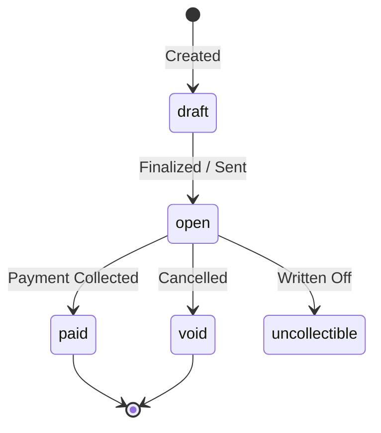

Pursar Invoicing allows businesses to issue professional, legally compliant invoices that customers can pay online via Mobile Money, Credit/Debit Cards, or Bank Transfer.

Invoices provide:
- Automated PDF invoice generation with your business branding and tax registration numbers.
- Hosted online invoice payment links (`hosted_invoice_url`) that can be emailed or sent via WhatsApp.
- Automatic payment reconciliation and receipt delivery upon successful settlement.
- Webhook notifications on invoice events (`invoice.created`, `invoice.paid`, `invoice.payment_failed`).

---

### Invoice Status Lifecycle

- `draft`: The invoice is still editable and has not been sent to the customer.
- `open`: The invoice has been finalized and is awaiting payment from the customer.
- `paid`: Full payment has been received and settled.
- `void`: The invoice was cancelled and cannot be paid.
- `uncollectible`: The invoice is past due and considered bad debt.
