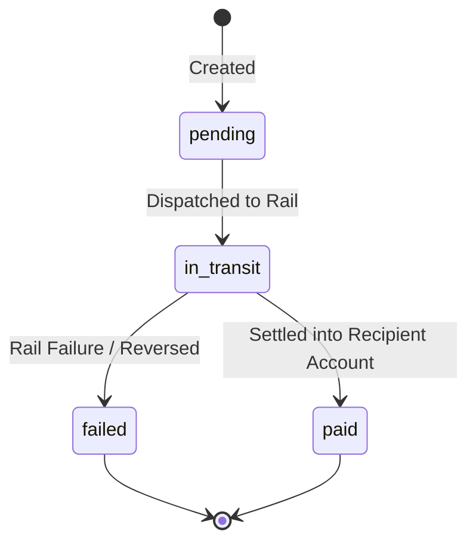

Pursar Payouts allow you to transfer funds from your available Pursar balance to your bank account or directly to third parties (contractors, vendors, creators, gig workers).

Pursar supports both automated scheduled settlements (daily, weekly, monthly) and on-demand programmatic payouts via the API.

---

### Supported Payout Rails

| Region | Supported Rails | Speed |
| :--- | :--- | :--- |
| **CEMAC (XAF)** | MTN MoMo, Orange Money, Express Union, Direct Bank (GIMAC) | Instant / Same-day |
| **UEMOA (XOF)** | Orange Money, Moov, Wave, MTN, Direct Bank (GIM-UEMOA) | Instant / Same-day |
| **Ghana (GHS)** | MTN Mobile Money, Vodafone Cash, AirtelTigo, GhIPSS Instant Pay | Instant / Same-day |
| **Kenya (KES)** | M-Pesa B2C / B2B, Pesalink, KEPSS Real-Time Gross Settlement | Instant / Same-day |
| **International (USD/EUR)** | SWIFT Wire, SEPA, ACH | 1–3 business days |

---

### Payout Lifecycle

A Payout transitions through the following statuses:

- `pending`: Payout requested and queued for processing.
- `in_transit`: Payout submitted to the underlying banking or mobile money network.
- `paid`: Funds have successfully reached the destination account.
- `failed`: Payout rejected by the receiving financial institution (e.g. invalid account number, KYC limit exceeded). Funds are automatically restored to your available balance.
