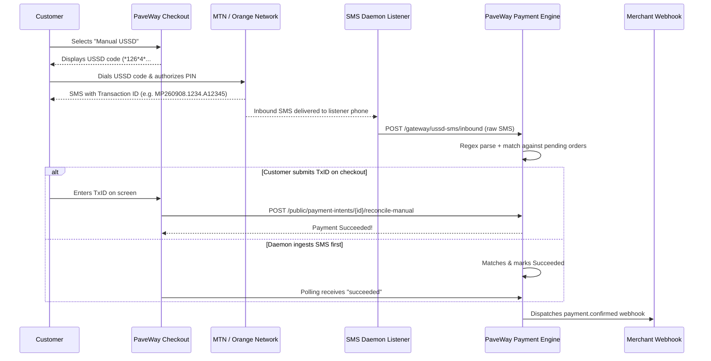

In many African markets (such as Cameroon, Côte d'Ivoire, and Senegal), automated STK push / USSD prompt delivery from telecom operators can occasionally experience network congestion or operator downtime. 

To guarantee 100% checkout completion, PaveWay provides a **Manual USSD Payment & Auto-Reconciliation Engine**. Customers can dial the standard telecom merchant USSD code directly from their phone, and PaveWay will automatically reconcile the transaction using incoming confirmation SMS messages.

---

## How It Works



---

## 1. Dial Codes & Operator Formatting

When a customer selects **Manual USSD** on your checkout, PaveWay generates a dynamic USSD code formatted with the merchant code and transaction amount:

| Operator | Dial Code Format | Example (Amount: 5,000 XAF) |
| :--- | :--- | :--- |
| **MTN MoMo** | `*126*4*{merchant_code}*{amount}#` | `*126*4*670000000*5000#` |
| **Orange Money** | `#150*4*1*{merchant_code}*{amount}#` | `#150*4*1*123456*5000#` |

Customers on mobile browsers can tap the **"Tap to dial"** button on the checkout screen to open their phone dialer pre-filled with the USSD code.

---

## 2. Inbound SMS Auto-Reconciliation API

If your organization deploys dedicated Android devices (running Android 4.4+ or specialized background daemon apps with SMS permissions), incoming SMS notifications from MTN or Orange can be forwarded automatically to PaveWay for real-time order matching.

### Endpoint

```http
POST /v1/ussd-sms/inbound
Authorization: Bearer sec_key_...
Content-Type: application/json
```

### Request Body

```json
{
  "raw_sms": "Paiement de 5000 FCFA a PAVEL GROUP reussi. Ref: MP260908.1402.A98765. Nouveau solde: 142000 FCFA.",
  "network": "MTN",
  "sender_phone": "+237671234567"
}
```

### Response

```json
{
  "success": true,
  "message": "USSD transaction automatically reconciled",
  "data": {
    "reconciled": true,
    "payment_ref": "PWG_TXN_987654",
    "transaction_hash": "MP260908.1402.A98765",
    "amount": 5000
  }
}
```

If no matching pending transaction is found immediately (e.g. if the SMS arrives before the customer finishes entering their details), the receipt is buffered in `UssdReceipt` with status `unmatched`. When the customer or merchant claims it later, it is instantly settled without delay.

---

## 3. Customer Self-Verification API

If the customer is completing checkout on the web, they can submit their Transaction ID directly:

### Endpoint

```http
POST /public/payment-intents/{id}/reconcile-manual
Content-Type: application/json
```

### Request Body

```json
{
  "client_secret": "pi_1234567890_secret_abc123xyz",
  "transaction_hash": "MP260908.1402.A98765",
  "customer_phone": "+237671234567"
}
```

### Response

```json
{
  "status": "success",
  "data": {
    "id": "658dc...",
    "status": "succeeded",
    "amount": "5000",
    "currency": "XAF",
    "payment_ref": "PWG_TXN_987654",
    "metadata": {
      "reconciled_via": "ussd_sms_buffer",
      "reconciliation_hash": "MP260908.1402.A98765"
    }
  }
}
```

---

## 4. Double-Spend & Fraud Prevention

PaveWay guarantees bank-grade security for manual USSD payments:

- **Strict Uniqueness**: Every transaction reference code / hash is stored and checked. If an already-claimed code is reused, PaveWay immediately responds with `409 Conflict`:
  ```json
  {
    "status_code": 409,
    "message": "This transaction hash reference has already been claimed or reconciled"
  }
  ```
- **Amount Tolerances**: When matching buffered receipts against PaymentIntents, the amount must match exactly (tolerance \(\le 0.01\)).
- **Time Limits**: Receipts expire after 2 hours if left unclaimed to prevent historical reuse.
