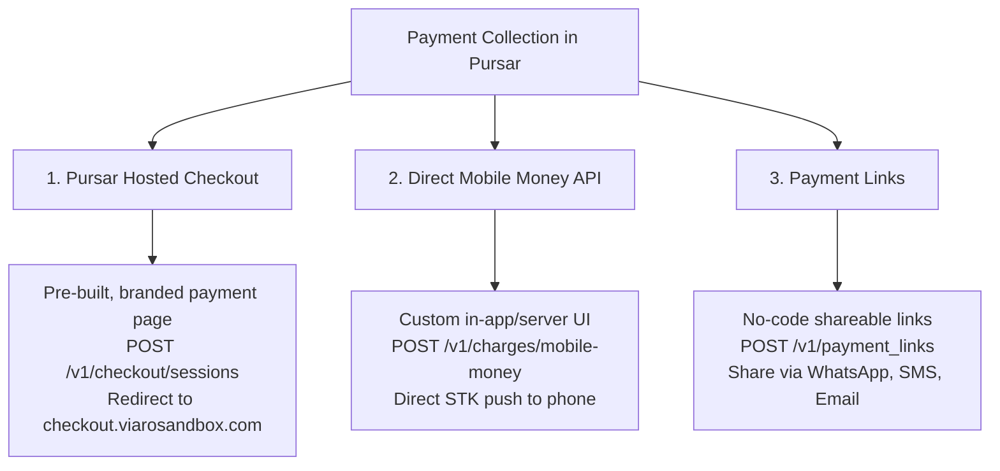
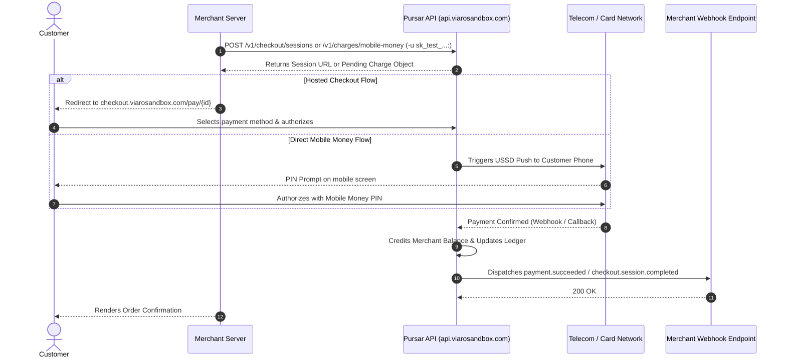

Pursar provides an enterprise-grade financial infrastructure for collecting payments globally, with deep native connectivity to Central and West African mobile money networks and international card schemes.

## Integration Approaches

Depending on your user experience requirements, Pursar supports three primary integration patterns:



| Approach | Best For | Implementation Effort |
| :--- | :--- | :--- |
| **Hosted Checkout** | E-commerce websites, SaaS platforms, digital checkouts. | Lowest (1 server API call + browser redirect) |
| **Direct Mobile Money API** | In-app mobile checkouts, POS terminals, custom headless billing. | Medium (Collect phone number on your frontend, charge from server) |
| **Payment Links** | Invoices, social commerce, WhatsApp/SMS payment requests. | Zero code (create via dashboard or single API call) |

---

## The Stripe-Standard Integration Flow

Pursar separates sensitive server-side charge orchestration from client-side confirmation.



---

## 1. Quickstart: Direct Mobile Money Charge

If you already have the customer's phone number and want to trigger an immediate USSD payment prompt on their phone (MTN MoMo, Orange Money, Moov, Express Union, etc.), use the Direct Mobile Money endpoint:

### Endpoint

```http
POST https://api.viarosandbox.com/v1/charges/mobile-money
Authorization: Basic base64(sk_test_...:)
Content-Type: application/json
Idempotency-Key: <unique-uuid>
```

<CodeGroup>
```bash cURL
curl -X POST https://api.viarosandbox.com/v1/charges/mobile-money \
  -u sk_test_live_secret_key_12345: \
  -H "Content-Type: application/json" \
  -H "Idempotency-Key: $(uuidgen)" \
  -d '{
    "amount": 25000,
    "currency": "XAF",
    "phone": "+237671234567",
    "customer_name": "Amara Diallo",
    "customer_email": "amara@example.com",
    "description": "Premium Service License #104",
    "merchant_reference": "ORD_2026_104",
    "fee_bearer": "merchant"
  }'
```

```python Python
import os
import uuid
import requests

api_key = os.getenv("PURSAR_SECRET_KEY", "sk_test_live_secret_key_12345")
base_url = "https://api.viarosandbox.com/v1"

response = requests.post(
    f"{base_url}/charges/mobile-money",
    auth=(api_key, ""),
    headers={
        "Content-Type": "application/json",
        "Idempotency-Key": str(uuid.uuid4()),
    },
    json={
        "amount": 25000,
        "currency": "XAF",
        "phone": "+237671234567",
        "customer_name": "Amara Diallo",
        "customer_email": "amara@example.com",
        "description": "Premium Service License #104",
        "merchant_reference": "ORD_2026_104",
        "fee_bearer": "merchant",
    },
)

charge = response.json()
print("Charge Status:", charge["status"], "Transaction ID:", charge["id"])
```

```javascript Node.js / TypeScript
import axios from 'axios';
import crypto from 'crypto';

const apiKey = process.env.PURSAR_SECRET_KEY || 'sk_test_live_secret_key_12345';
const baseUrl = 'https://api.viarosandbox.com/v1';

async function chargeMobileMoney() {
  const response = await axios.post(
    `${baseUrl}/charges/mobile-money`,
    {
      amount: 25000,
      currency: 'XAF',
      phone: '+237671234567',
      customer_name: 'Amara Diallo',
      customer_email: 'amara@example.com',
      description: 'Premium Service License #104',
      merchant_reference: 'ORD_2026_104',
      fee_bearer: 'merchant'
    },
    {
      auth: { username: apiKey, password: '' },
      headers: {
        'Content-Type': 'application/json',
        'Idempotency-Key': crypto.randomUUID()
      }
    }
  );

  return response.data;
}
```
</CodeGroup>

### Response (200 OK)

```json
{
  "id": "tx_9182374b12c8",
  "status": "pending",
  "amount": 25000,
  "currency": "XAF",
  "phone": "+237671234567",
  "network": "MTN",
  "customer_name": "Amara Diallo",
  "customer_email": "amara@example.com",
  "merchant_reference": "ORD_2026_104",
  "fee": 250,
  "net_amount": 24750,
  "message": "Payment prompt sent to customer phone. Please authorize with PIN.",
  "created_at": "2026-11-06T12:00:00.000Z"
}
```

---

## 2. Server-Side Verification

After a charge is initiated or when a customer returns from checkout, verify the transaction status using your secret key:

```bash
curl -X GET https://api.viarosandbox.com/v1/transactions/tx_9182374b12c8 \
  -u sk_test_live_secret_key_12345:
```

### Response

```json
{
  "id": "tx_9182374b12c8",
  "status": "succeeded",
  "amount": 25000,
  "currency": "XAF",
  "customer_name": "Amara Diallo",
  "customer_email": "amara@example.com",
  "merchant_reference": "ORD_2026_104",
  "fee": 250,
  "net_amount": 24750,
  "payment_method": "mobile_money",
  "payment_provider": "mtn_cameroon",
  "created_at": "2026-11-06T12:00:00.000Z",
  "settled_at": "2026-11-06T12:00:14.000Z"
}
```

---

## Supported Payment Methods & Regions

| Category | Providers / Channels | Regions Covered |
| :--- | :--- | :--- |
| **Mobile Money** | MTN MoMo, Orange Money, Moov Africa, Express Union Mobile, Airtel Money, M-Pesa | Cameroon (CEMAC), Côte d'Ivoire & Senegal (UEMOA), Ghana, Kenya, Uganda, Rwanda |
| **Cards** | Visa, Mastercard, American Express (via Stripe & Flutterwave) | Worldwide (135+ currencies) |
| **Digital Wallets** | PayPal | Global |
| **Manual USSD** | Automated SMS-reconciled merchant code transfers (`*126*4*...#`, `#150*4*1*...#`) | CEMAC / UEMOA fallback resilience |
| **Bank Transfer** | NIP, ACH, SEPA, Virtual Bank Accounts | Nigeria, International Wire |
