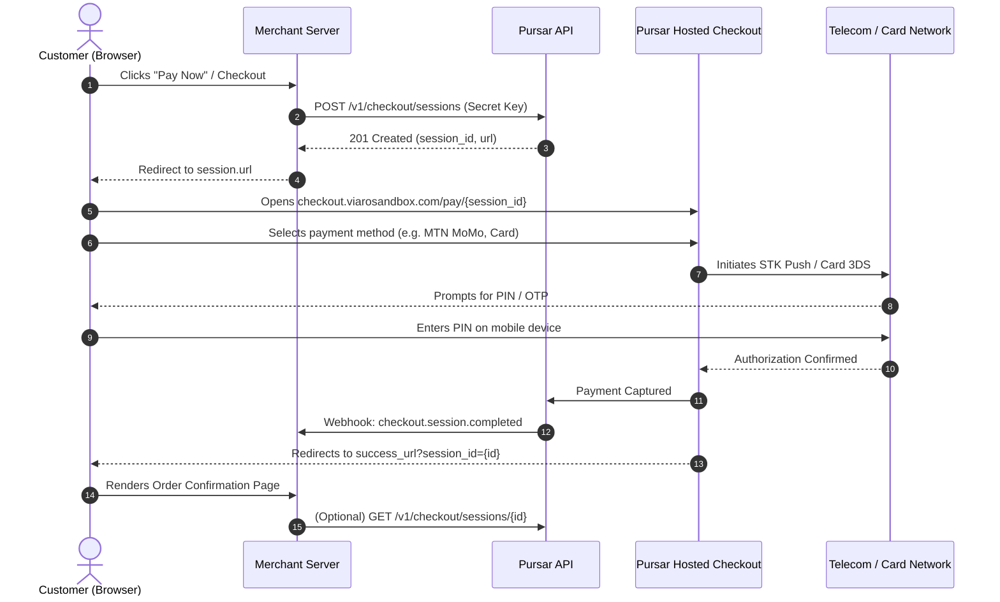

Pursar Checkout is a pre-built, high-converting hosted payment page designed for African and global commerce. It handles payment method selection, local currency formatting, telecom USSD prompts, 3D Secure card challenges, and mobile responsiveness out of the box.



---

## 1. Create a Checkout Session (Server-Side)

When your customer is ready to pay, make an authenticated request from your backend to create a Checkout Session. Never create sessions using public keys or client-side JavaScript.

### Endpoint

```http
POST https://api.viarosandbox.com/v1/checkout/sessions
Authorization: Basic base64(sk_test_...:)
Content-Type: application/json
Idempotency-Key: <unique-uuid>
```

> [!TIP]
> Pursar supports **HTTP Basic Authentication** (`-u sk_test_...:`) and Bearer tokens (`Authorization: Bearer sk_test_...`). Always supply a unique `Idempotency-Key` header to safely retry requests without double-billing.

<CodeGroup>
```bash cURL
curl -X POST https://api.viarosandbox.com/v1/checkout/sessions \
  -u sk_test_live_secret_key_12345: \
  -H "Content-Type: application/json" \
  -H "Idempotency-Key: $(uuidgen)" \
  -d '{
    "amount": 25000,
    "currency": "XAF",
    "customer_name": "Amara Diallo",
    "customer_email": "amara@example.com",
    "description": "Annual Professional License #104",
    "merchant_reference": "ORD_2026_104",
    "payment_method_types": ["mobile_money", "card", "paypal", "manual_ussd"],
    "success_url": "https://yourdomain.com/checkout/success?session_id={CHECKOUT_SESSION_ID}",
    "cancel_url": "https://yourdomain.com/checkout/canceled",
    "metadata": {
      "order_id": "ORD_2026_104",
      "user_id": "usr_98765"
    }
  }'
```

```python Python
import os
import uuid
import requests

api_key = os.getenv("PURSAR_SECRET_KEY", "sk_test_live_secret_key_12345")
base_url = "https://api.viarosandbox.com/v1"

response = requests.post(
    f"{base_url}/checkout/sessions",
    auth=(api_key, ""),
    headers={
        "Content-Type": "application/json",
        "Idempotency-Key": str(uuid.uuid4()),
    },
    json={
        "amount": 25000,
        "currency": "XAF",
        "customer_name": "Amara Diallo",
        "customer_email": "amara@example.com",
        "description": "Annual Professional License #104",
        "merchant_reference": "ORD_2026_104",
        "payment_method_types": ["mobile_money", "card", "paypal", "manual_ussd"],
        "success_url": "https://yourdomain.com/checkout/success?session_id={CHECKOUT_SESSION_ID}",
        "cancel_url": "https://yourdomain.com/checkout/canceled",
        "metadata": {
            "order_id": "ORD_2026_104",
            "user_id": "usr_98765"
        },
    },
)

session = response.json()
print("Redirect customer to:", session["url"])
```

```javascript Node.js / TypeScript
import axios from 'axios';
import crypto from 'crypto';

const apiKey = process.env.PURSAR_SECRET_KEY || 'sk_test_live_secret_key_12345';
const baseUrl = 'https://api.viarosandbox.com/v1';

async function createCheckoutSession() {
  const response = await axios.post(
    `${baseUrl}/checkout/sessions`,
    {
      amount: 25000,
      currency: 'XAF',
      customer_name: 'Amara Diallo',
      customer_email: 'amara@example.com',
      description: 'Annual Professional License #104',
      merchant_reference: 'ORD_2026_104',
      payment_method_types: ['mobile_money', 'card', 'paypal', 'manual_ussd'],
      success_url: 'https://yourdomain.com/checkout/success?session_id={CHECKOUT_SESSION_ID}',
      cancel_url: 'https://yourdomain.com/checkout/canceled',
      metadata: {
        order_id: 'ORD_2026_104',
        user_id: 'usr_98765'
      }
    },
    {
      auth: { username: apiKey, password: '' },
      headers: {
        'Content-Type': 'application/json',
        'Idempotency-Key': crypto.randomUUID()
      }
    }
  );

  return response.data; // contains { id, url, ... }
}
```
</CodeGroup>

### Response (201 Created)

```json
{
  "id": "cs_test_92384a8b1c4e",
  "object": "checkout.session",
  "status": "open",
  "payment_status": "unpaid",
  "amount": 25000,
  "currency": "XAF",
  "customer_name": "Amara Diallo",
  "customer_email": "amara@example.com",
  "description": "Annual Professional License #104",
  "merchant_reference": "ORD_2026_104",
  "url": "https://checkout.viarosandbox.com/pay/cs_test_92384a8b1c4e",
  "success_url": "https://yourdomain.com/checkout/success?session_id={CHECKOUT_SESSION_ID}",
  "cancel_url": "https://yourdomain.com/checkout/canceled",
  "expires_at": 1762438800,
  "created_at": 1762435200,
  "metadata": {
    "order_id": "ORD_2026_104",
    "user_id": "usr_98765"
  }
}
```

---

## 2. Redirect the Customer to Pursar Hosted Checkout

Redirect the user's browser to the `url` property returned in the session object.

### Next.js (App Router Server Action)

```typescript
import { redirect } from 'next/navigation';

export async function handleCheckout(formData: FormData) {
  'use server';

  const session = await createCheckoutSession();
  redirect(session.url);
}
```

### Express.js

```javascript
app.post('/create-checkout-session', async (req, res) => {
  try {
    const session = await createCheckoutSession();
    res.redirect(303, session.url);
  } catch (error) {
    res.status(500).json({ error: error.message });
  }
});
```

---

## 3. Handle Order Completion & Verification

When the customer completes their payment, Pursar replaces the `{CHECKOUT_SESSION_ID}` template variable in your `success_url` with the actual session ID and redirects them back to your site:

```
https://yourdomain.com/checkout/success?session_id=cs_test_92384a8b1c4e
```

### Verify Session State

On your success page, you can retrieve the session status to display an immediate order confirmation to the customer:

```bash
curl -X GET https://api.viarosandbox.com/v1/checkout/sessions/cs_test_92384a8b1c4e \
  -u sk_test_live_secret_key_12345:
```

### Response

```json
{
  "id": "cs_test_92384a8b1c4e",
  "object": "checkout.session",
  "status": "complete",
  "payment_status": "paid",
  "amount": 25000,
  "currency": "XAF",
  "payment_intent_id": "pi_1234567890",
  "customer_email": "amara@example.com",
  "customer_name": "Amara Diallo",
  "merchant_reference": "ORD_2026_104",
  "metadata": {
    "order_id": "ORD_2026_104"
  }
}
```

---

## 4. Webhook Fulfillment (Critical)

> [!IMPORTANT]
> Never rely exclusively on the client-side browser redirect for business fulfillment. Network disconnects, closed browser tabs, or slow mobile connections can prevent the customer from returning to your `success_url`. Always fulfill orders asynchronously when receiving the `checkout.session.completed` webhook.

Pursar signs every webhook event using an HMAC-SHA256 signature in the `X-Pursar-Signature` header.

### Webhook Event Payload (`checkout.session.completed`)

```json
{
  "id": "evt_019318b2_8291",
  "event_type": "checkout.session.completed",
  "business_id": "bus_live_12345",
  "created_at": "2026-11-06T12:00:00.000Z",
  "data": {
    "id": "cs_test_92384a8b1c4e",
    "object": "checkout.session",
    "status": "complete",
    "payment_status": "paid",
    "amount": 25000,
    "currency": "XAF",
    "merchant_reference": "ORD_2026_104",
    "customer_name": "Amara Diallo",
    "customer_email": "amara@example.com",
    "metadata": {
      "order_id": "ORD_2026_104",
      "user_id": "usr_98765"
    }
  }
}
```

### Node.js Webhook Handler Example

```javascript
import express from 'express';
import crypto from 'crypto';

const app = express();
const endpointSecret = process.env.PURSAR_WEBHOOK_SECRET; // whsec_...

// Use raw body for signature verification
app.post('/webhook', express.raw({ type: 'application/json' }), (req, res) => {
  const sigHeader = req.headers['x-pursar-signature'] || req.headers['stripe-signature'];

  if (!sigHeader) {
    return res.status(400).send('Missing signature header');
  }

  // Parse t=<timestamp>,v1=<signature>
  const parts = Object.fromEntries(sigHeader.split(',').map(p => p.split('=')));
  const timestamp = parts.t;
  const signature = parts.v1;

  // Verify HMAC-SHA256
  const payloadToSign = `${timestamp}.${req.body.toString('utf8')}`;
  const expectedSignature = crypto
    .createHmac('sha256', endpointSecret)
    .update(payloadToSign)
    .digest('hex');

  if (crypto.timingSafeEqual(Buffer.from(signature), Buffer.from(expectedSignature))) {
    const event = JSON.parse(req.body.toString('utf8'));

    if (event.event_type === 'checkout.session.completed') {
      const session = event.data;
      console.log(`Fulfilling order ${session.merchant_reference} for ${session.customer_email}`);
      // Fulfill order, deliver digital license, credit account
    }

    return res.status(200).json({ received: true });
  }

  return res.status(400).send('Invalid webhook signature');
});
```

---

## 5. Live vs Sandbox Hosted URLs

| Environment | Base API Domain | Hosted Checkout URL |
| :--- | :--- | :--- |
| **Sandbox (Test)** | `https://api.viarosandbox.com/v1` | `https://checkout.viarosandbox.com/pay/{session_id}` |
| **Production (Live)** | `https://api.pursar.com/v1` | `https://checkout.pursar.com/pay/{session_id}` |

Your hosted checkout sessions automatically display your **Business Name**, **Brand Logo**, and **Accent Color** configured in your [Business Dashboard](https://business.viarosandbox.com/settings).
