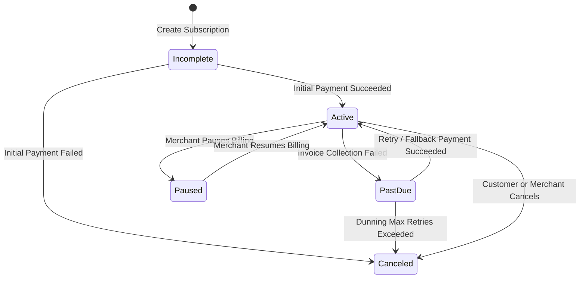

Pursar Billing enables SaaS platforms, digital content creators, utility providers, and membership communities to bill customers automatically on recurring cycles (daily, weekly, monthly, or yearly) across both saved credit cards and scheduled Mobile Money prompts.

---

## Subscription Lifecycle



---

## 1. Create a Product & Price Plan

Before subscribing customers, create a Product with a recurring Price plan:

```bash
curl -X POST https://api.viarosandbox.com/v1/products \
  -u sk_test_live_secret_key_12345: \
  -H "Content-Type: application/json" \
  -d '{
    "name": "Pursar Pro Subscription",
    "description": "Unlimited team access and automated reporting",
    "price": 10000,
    "currency": "XAF",
    "interval": "month"
  }'
```

---

## 2. Subscribe a Customer

Attach an existing Customer (`cus_...`) to the recurring plan:

```bash
curl -X POST https://api.viarosandbox.com/v1/subscriptions \
  -u sk_test_live_secret_key_12345: \
  -H "Content-Type: application/json" \
  -d '{
    "customer_id": "cus_0192384a_1234",
    "plan_id": "plan_pro_monthly",
    "payment_method": "mobile_money",
    "mobile_money": {
      "phone": "+237671234567",
      "network": "MTN"
    },
    "preferred_time": {
      "hour": 18,
      "minute": 0,
      "timezone": "Africa/Douala"
    },
    "fee_bearer": "merchant"
  }'
```

### Response

```json
{
  "id": "sub_019318b2_8291",
  "status": "active",
  "customer_id": "cus_0192384a_1234",
  "plan_id": "plan_pro_monthly",
  "amount": 10000,
  "currency": "XAF",
  "current_period_start": "2026-11-06T12:00:00.000Z",
  "current_period_end": "2026-12-06T12:00:00.000Z",
  "cancel_at_period_end": false
}
```

---

## 3. Webhook Fulfillment for Recurring Invoices

Listen for subscription lifecycle events on your webhook endpoint:

| Event Type | Trigger Condition | Action Required |
| :--- | :--- | :--- |
| `invoice.paid` | Recurring cycle billing succeeded. | Extend customer service period or grant subscription entitlement. |
| `invoice.payment_failed` | USSD prompt timed out, customer declined, or card had insufficient funds. | Send payment reminder notification; enter grace period. |
| `customer.subscription.canceled` | Customer canceled or dunning retries exhausted. | Revoke access at period end. |
